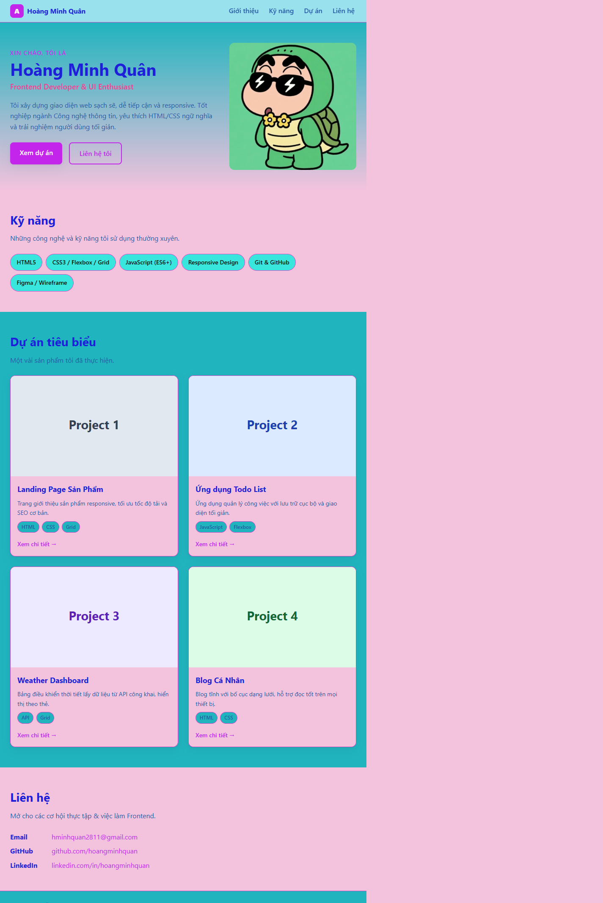
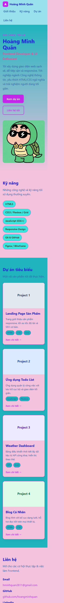

# Báo cáo kiểm thử

- **Sản phẩm:** Portfolio CV cá nhân
- **Phiên bản:** v1.0
- **Ngày kiểm thử:** 27/10/2026
- **Phạm vi:** Kiểm tra trang `index.html`, stylesheet và hướng dẫn chạy trong `README.md`.
- **Môi trường:** Trình duyệt tích hợp VS Code; kiểm tra giao diện desktop và mobile.
- **Cách kiểm tra:** Mở trang, quan sát giao diện, kiểm tra các mục điều hướng, liên kết, ảnh và kích thước nội dung trên mobile. Ảnh minh chứng được chụp trực tiếp từ trang đang chạy.

## Kết quả theo tiêu chí

### 1. Tính đúng đắn — Đạt một phần

- Trang hiển thị tiêu đề và các mục Giới thiệu, Kỹ năng, Dự án, Liên hệ; các ID mục tiêu tương ứng với điều hướng trong trang.
- Tại thời điểm kiểm tra, cả ảnh đại diện và bốn ảnh minh họa dự án đều tải được.
- Phát hiện thông tin chưa nhất quán: tiêu đề trang ghi “Hoàng Minh Quân”, trong khi metadata, nội dung mô tả ảnh đại diện và chân trang ghi “Nguyễn Văn An”.
- Có **6 liên kết `href="#"`** (bốn liên kết xem chi tiết dự án và hai liên kết hồ sơ), chưa dẫn đến nội dung/hồ sơ thật.

### 2. UI/UX — Đạt một phần

- Giao diện có bố cục desktop và mobile; danh sách dự án chuyển thành một cột ở màn hình hẹp, menu có thể xuống dòng và không phát hiện tràn ngang trong lần kiểm tra mobile.
- Các nút và liên kết điều hướng tới phần tương ứng trong trang.
- Bảng màu hiện tại dùng nhiều màu nền và màu nhấn bão hòa, làm giảm sự đồng nhất và thoải mái khi đọc. Cần rà soát thêm độ tương phản và khả năng tiếp cận trên nhiều thiết bị.
- Minh chứng giao diện: [ảnh desktop](screenshots/portfolio-desktop.png), [ảnh mobile](screenshots/portfolio-mobile.png).

### 3. Khả năng vận hành - xử lý lỗi — Đạt một phần

- Trang tĩnh mở và hiển thị được trực tiếp trong trình duyệt; không cần backend hoặc bước build.
- Không có biểu mẫu hay chức năng gửi dữ liệu để kiểm tra xử lý lỗi nghiệp vụ. Trang cũng chưa có cơ chế dự phòng được xác minh nếu ảnh đại diện từ máy chủ bên ngoài không tải được.
- Việc kiểm tra chỉ xác nhận trang mở bằng `file://`; chưa kiểm thử lỗi máy chủ HTTP, Docker hoặc các trình duyệt khác.

### 4. Bảo mật — Đạt một phần

- Phạm vi hiện tại là trang tĩnh, không thấy mã JavaScript, xử lý dữ liệu người dùng, thông tin xác thực hoặc kết nối cơ sở dữ liệu trong các thành phần đã kiểm tra.
- Ảnh đại diện tải từ tên miền bên ngoài, tạo phụ thuộc bên thứ ba và có thể tiết lộ yêu cầu truy cập tới nhà cung cấp ảnh.
- Chưa kiểm thử cấu hình bảo mật ở môi trường triển khai (ví dụ HTTPS, security headers) hoặc thực hiện quét/lỗ hổng chuyên sâu; kết quả này không thay thế đánh giá bảo mật chính thức.

### 5. Chất lượng mã nguồn — Đạt một phần

- HTML dùng các phần tử có ngữ nghĩa như `header`, `nav`, `main`, `section`, `article` và `footer`; CSS được tách riêng, có cấu trúc responsive và văn bản thay thế cho ảnh.
- Phát hiện dữ liệu tên hiển thị không nhất quán và các liên kết mẫu chưa hoàn thiện.
- Chưa có bộ kiểm thử tự động, cấu hình lint hoặc kết quả kiểm định HTML/CSS trong phạm vi kiểm tra này.

### 6. Khả năng triển khai — Đạt một phần

- `README.md` hướng dẫn chạy bằng máy chủ HTTP cục bộ và Docker/Nginx; trang không cần cài dependency để hiển thị.
- Đã xác nhận trang mở trực tiếp từ tệp HTML trong trình duyệt.
- Chưa thực thi quy trình Docker/Nginx hoặc triển khai lên máy chủ thực tế, nên chưa xác nhận các bước đó hoạt động trong môi trường đích.

## Minh chứng hình ảnh

Ảnh được chụp trực tiếp từ trang portfolio và lưu trong `docs/screenshots/`:

